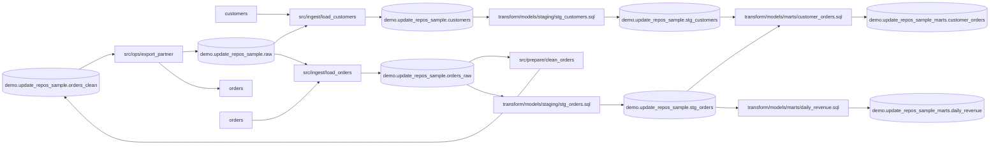

# Data flows

What the code reads and writes, from the code and from Unity Catalog lineage.

| Data | Written by | Read by |
|---|---|---|
| `customers` | - | `src/ingest/load_customers` |
| `demo.update_repos_sample.customers` | `src/ingest/load_customers` | `transform/models/staging/stg_customers.sql` |
| `demo.update_repos_sample.orders_clean` | `src/prepare/clean_orders` | `src/ops/export_partner` |
| `demo.update_repos_sample.orders_raw` | `src/ingest/load_orders` | `src/prepare/clean_orders`, `transform/models/staging/stg_orders.sql` |
| `demo.update_repos_sample.raw` | `src/ops/export_partner` | `src/ingest/load_customers`, `src/ingest/load_orders` |
| `demo.update_repos_sample.stg_customers` (created by the code; not in the workspace yet) | `transform/models/staging/stg_customers.sql` | `transform/models/marts/customer_orders.sql` |
| `demo.update_repos_sample.stg_orders` (created by the code; not in the workspace yet) | `transform/models/staging/stg_orders.sql` | `transform/models/marts/customer_orders.sql`, `transform/models/marts/daily_revenue.sql` |
| `demo.update_repos_sample_marts.customer_orders` (created by the code; not in the workspace yet) | `transform/models/marts/customer_orders.sql` | - |
| `demo.update_repos_sample_marts.daily_revenue` (created by the code; not in the workspace yet) | `transform/models/marts/daily_revenue.sql` | - |
| `orders` | - | `src/ingest/load_orders` |
| `orders` | `src/ops/export_partner` | - |
